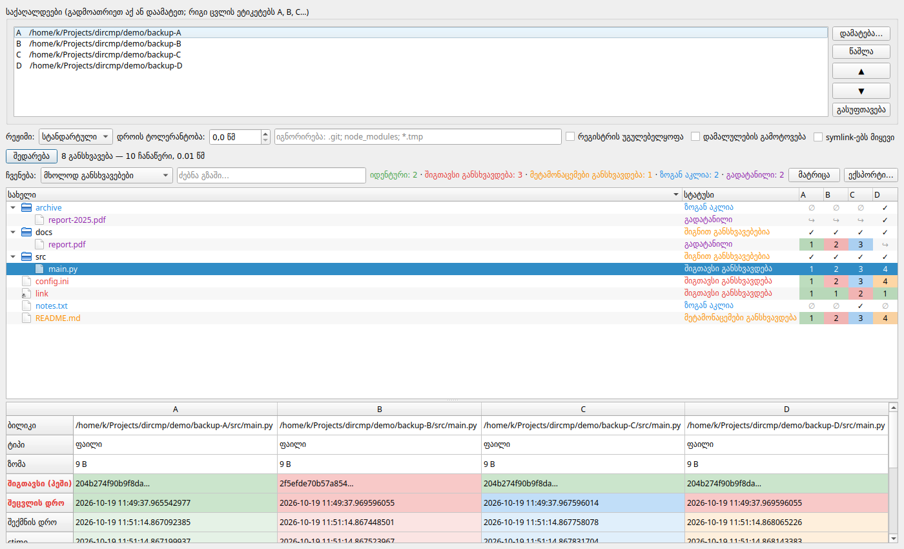

# dircmp

ორი, სამი, ოთხი და მეტი საქაღალდის სიღრმისეული შედარება. ხელსაწყო მხოლოდ კითხულობს და არაფერს ცვლის.
*Deep, read-only comparison of two or more directories — CLI and Qt GUI.*



## რას ადარებს

| ველი | დეტალები |
|---|---|
| სტრუქტურა | რომელ საქაღალდეებშია გზა, ტიპის შეცვლა (ფაილი ↔ საქაღალდე ↔ symlink) |
| ზომა და შიგთავსი | BLAKE2b ჰეში; ჯერ ზომა, მერე თავი+ბოლოს ნაწილობრივი ჰეში, სრული მხოლოდ საჭიროებისას |
| დროები | შეცვლის (mtime), შექმნის (birth; Linux-ზე `statx`), წვდომის, ctime; ტოლერანტობით |
| უფლებები | Unix mode, uid/gid; Windows readonly/hidden/system |
| სხვა | symlink-ის სამიზნე, xattr (ღრმა რეჟიმი, Linux) |
| გადატანა | იგივე შიგთავსი სხვა გზაზე → „გადატანილი“ და არა „წაშლილი + დამატებული“ |

## N საქაღალდე: ჯგუფური შედარება

ეტალონი არ არის. ყოველი გზისთვის საქაღალდეები იყოფა ჯგუფებად, რომელთა მნიშვნელობები ემთხვევა:

```
[შიგთავსი განსხვავდება] src/main.py   A=C=D ≠ B   (content)
[ზოგან აკლია]          notes.txt     C  ∅ A,B,D
[გადატანილი]           docs/report.pdf   A=B=C  ∅ D
      → D: archive/report-2025.pdf
```

მატრიცა აჩვენებს, რამდენ გზაზე არ ემთხვევა ყოველი წყვილი, ასე რომ მაშინვე ჩანს, რომელი ასლი „გადაუხვია“ დანარჩენებს. საქაღალდეების რაოდენობა შეზღუდული არ არის (ეტიკეტები A…Z, AA, AB…).

## ინსტალაცია

### მზა ბინარები

[Releases](https://github.com/kapo-Toolkits/dircmp/releases/latest) გვერდზე თითოეული OS-ისთვის არის დამოუკიდებელი ფაილები; Python-ის დაყენება საჭირო არ არის:

| OS | GUI | CLI |
|---|---|---|
| Windows (x64) | `dircmp-gui-<ver>-windows-x86_64.exe` | `dircmp-<ver>-windows-x86_64.exe` |
| macOS (Apple Silicon) | `dircmp-gui-<ver>-macos-arm64.zip` (`dircmp.app`) | `dircmp-<ver>-macos-arm64` |
| Linux (x86_64) | `dircmp-gui-<ver>-linux-x86_64` | `dircmp-<ver>-linux-x86_64` |

`SHA256SUMS.txt`-ით შეგიძლიათ ჩამოტვირთული ფაილის შემოწმება.

- **Linux / macOS CLI:** ჩამოტვირთვის შემდეგ `chmod +x dircmp-*` და გაუშვით. Linux-ის ბინარები აწყობილია Ubuntu 22.04-ზე (glibc 2.35+).
- **macOS:** ბინარები ხელმოწერილი არ არის, ამიტომ Gatekeeper პირველ გაშვებას დაბლოკავს. `dircmp.app`-ზე მარჯვენა ღილაკი → Open, ან: `xattr -dr com.apple.quarantine dircmp.app`.
- **Windows:** SmartScreen-ის გაფრთხილებისას: More info → Run anyway.

### წყაროდან

```bash
git clone https://github.com/kapo-Toolkits/dircmp.git
cd dircmp
python -m venv .venv && . .venv/bin/activate
pip install -e ".[gui]"
```

Python 3.12+ საჭიროა. ბირთვს და CLI-ს გარე დამოკიდებულება არ აქვს; GUI-ს სჭირდება PySide6.

საკუთარი ბინარის აწყობა (შედეგი `dist/release/`-ში):

```bash
pip install pyinstaller
python packaging/build.py
```

## გამოყენება

```bash
dircmp-gui                       # GUI
dircmp /backup/a /backup/b /mnt/usb/c -v
dircmp A B C D -f json -o report.json --all
dircmp A B --mode quick --ignore .git --ignore '*.tmp' --time-tolerance 2
```

| პარამეტრი | |
|---|---|
| `-m quick\|standard\|deep` | სწრაფი: ზომა + mtime; სტანდარტული (ნაგულისხმევი): + შიგთავსი, უფლებები, შექმნის დრო; ღრმა: + ყველა ფაილის სრული ჰეში, xattr |
| `-i GLOB` | იგნორირება (რამდენჯერმე; `/`-იანი შაბლონი ფარდობით გზას ედარება) |
| `-t SEC` | დროის ტოლერანტობა (FAT-ისთვის 2) |
| `--fields kind,size,content` | რომელი ველები განსაზღვრავს სტატუსს |
| `--case-insensitive`, `--no-unicode-normalize` | სახელების დამთხვევის წესები (NFC/NFD ნაგულისხმევად ერთია) |
| `--exclude-hidden`, `--follow-symlinks`, `--no-moves` | |
| `-f text\|json\|csv`, `-o FILE`, `-a`, `-v` | ანგარიშის ფორმატი |

**Exit code:** `0` ყველაფერი იდენტურია, `1` განსხვავებებია, `2` შეცდომა (მაგ. წაუკითხავი ფაილი), რაც CI-ში გამოსადეგია.

ნაგულისხმევად სტატუსზე გავლენას ახდენს: ტიპი, ზომა, შიგთავსი, mtime, უფლებები, Windows ატრიბუტები, symlink-ის სამიზნე. შექმნის/წვდომის დრო და მფლობელი ნაჩვენებია, მაგრამ ასლებში თითქმის ყოველთვის განსხვავდება, ამიტომ ნაგულისხმევად არ ითვლება (`--fields`-ით ჩაირთვება).

## სტრუქტურა

```
dircmp/core/      სკანერი, მოდელი, ჰეშირება, N-მხრივი დაჯგუფება (GUI-სგან დამოუკიდებელი)
dircmp/platform/  OS-სპეციფიკური: statx, Windows ატრიბუტები, xattr
dircmp/report/    text / json / csv
dircmp/gui/       PySide6
packaging/        PyInstaller: build.py, smoke.py
tests/            pytest
```

## შემდეგი ეტაპები

- HTML ანგარიში
- Windows ACL და NTFS Alternate Data Streams, macOS xattr

## ლიცენზია

MIT
